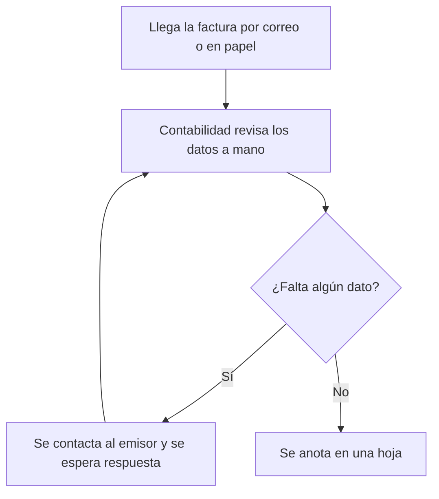

# Bitácora unificada — Procesamiento automatizado de facturas

> **Cómo usar este documento.** Describe el estado **actual** del proyecto (versión `facturas-21/10`, ruta de webhook `factura-c08`). Las bitácoras por clase están en `documentacion/historial/` solo como historial; cuando una de ellas contradice este documento, **este documento manda**.
>
> Los textos entre `[COMPLETAR: ...]` son datos que solo el equipo conoce (nombres de archivos de captura, versión de n8n, etc.). Búsquelos con Ctrl+F y reemplácelos antes de entregar.

---

## 1. Identificación y alcance

| Campo | Registro |
|---|---|
| Proyecto | Procesamiento automatizado de facturas con n8n y Baserow |
| Curso / institución | Automatización inteligente de procesos con n8n, EAM, 2026 II |
| Equipo | Equipo_JuanMunoz |
| Fecha de actualización | 2026-10-26 |
| Versión de n8n utilizada | [COMPLETAR: versión, visible en Settings → About] |
| Repositorio | [COMPLETAR: enlace al repositorio de GitHub] |

### Integrantes y responsabilidades

| Integrante | Responsabilidad |
|---|---|
| Juan Esteban Muñoz Díaz | Diseño y construcción de los tres workflows, base de datos en Baserow, pruebas y documentación |
| [COMPLETAR: otros integrantes, o aclarar que el proyecto lo desarrolló una sola persona] | [COMPLETAR] |

### Problema

Una persona o un área de contabilidad recibe facturas por correo, en papel o desde el sistema de un proveedor. Cada factura se revisa a mano: se verifica que traiga número, cliente, monto y estado; se pregunta al emisor cuando falta algo; y el dato se anota en una hoja. Ese proceso es lento, repetitivo, y permite errores de digitación y facturas registradas dos veces.

### Objetivo de la automatización

Recibir una factura (desde un formulario o desde otro sistema por HTTP), validarla, limpiar sus datos, evitar duplicados, guardarla en una base de datos (Baserow) y devolver al emisor una respuesta que corresponda a lo que realmente ocurrió. Cuando falla un servicio técnico, dejar un incidente registrado y avisar.

### Qué incluye esta versión

- Tres entradas al mismo proceso: formulario de n8n, ejecución manual de prueba y Webhook autenticado.
- Validación de los 4 campos obligatorios en el Webhook.
- Protección del Webhook con credencial Header Auth.
- Revisión de duplicados contra Baserow (solo en la entrada Webhook).
- Un subworkflow reutilizable que limpia el estado y el cliente.
- Guardado de la factura en la tabla `Facturas` de Baserow mediante HTTP Request.
- Manejo de errores: respuesta honesta (502), ejecución marcada como fallida, workflow manejador, registro en la tabla `Incidentes` y aviso por Discord.

### Qué queda fuera del alcance

- Lectura automática de facturas desde archivos o correos (PDF, imágenes, OCR).
- Reintentos automáticos de guardado.
- Garantía de unicidad en la base de datos (ver sección 8).
- Túnel o servidor público permanente para recibir facturas desde Internet.
- Validación contable del contenido (por ejemplo, que el monto sea positivo o que el cliente exista).

---

## 2. Proceso manual y proceso automatizado

### 2.1 Proceso manual (antes)

1. Llega la factura por correo o en papel.
2. Contabilidad revisa los datos a mano.
3. Si falta un dato, se contacta al emisor.
4. Se anota en una hoja.

**Dónde aparecen los problemas:** la revisión depende de una persona; no hay control de duplicados; los datos se digitan varias veces; no queda registro de cuándo ni por qué falló algo.



Imagen exportada: `diagramas/Proceso_Manual.png` [COMPLETAR: exportar el diagrama a PNG]

### 2.2 Proceso automatizado (ahora)

```mermaid
flowchart LR
    W["Webhook POST /factura-c08"] --> A{"¿Clave correcta?"}
    A -- No --> X1["403 Forbidden"]
    A -- Sí --> B{"¿Vienen los 4 campos?"}
    B -- No --> X2["400 Faltan campos"]
    B -- Sí --> N{"¿entrada normal? (forzar_error)"}
    N -- No --> T["Stop and Error: fallo controlado de prueba"]
    N -- Sí --> NE["Normalizar entrada"]
    NE --> D["Baserow: buscar duplicado (GET)"]
    D --> C{"¿Factura nueva? (count = 0)"}
    C -- No --> X3["409 Duplicada"]
    C -- Sí --> R["Restaurar datos de la factura"]
    F["Formulario de n8n"] --> RD
    M["Ejecución manual de prueba"] --> RD
    R --> RD["Recibir datos factura"]
    RD --> S["Subworkflow: limpiar estado y cliente"]
    S --> E{"¿estado_limpio = completa?"}
    E -- Sí --> OC["Armar salida (completa)"]
    E -- No --> OI["Armar salida (incompleta)"]
    OC --> G["Baserow: guardar fila (POST)"]
    OI --> G
    G -- Éxito --> OK["200 ok:true"]
    G -- Error --> FL["502 ok:false"]
    FL --> SE["Stop and Error: ejecución fallida"]
    SE --> EH["Workflow manejador de errores"]
    EH --> INC["Baserow: tabla Incidentes (POST)"]
    INC --> DC["Discord: aviso"]
```



Imagen exportada: `diagramas/Proceso_Automatizado.png` [COMPLETAR: exportar el diagrama a PNG]

**Nota:** en la versión actual, la revisión de duplicados y la validación de campos obligatorios solo existen en la entrada por Webhook. El formulario y la ejecución manual pasan directamente al subworkflow.

---

## 3. Funcionamiento de la solución

### 3.1 Los tres workflows

| Workflow | Responsabilidad | Recibe | Devuelve |
|---|---|---|---|
| `facturas-21/10` (principal) | Recibir facturas por tres entradas, validar, evitar duplicados, decidir la ruta, guardar en Baserow y responder | Formulario, ejecución manual o POST al Webhook | Respuesta HTTP al emisor (en la entrada Webhook) y una fila en `Facturas` |
| `Subworkflow - Preparar Factura` | Limpiar el estado y el cliente. Una sola versión reutilizada por las tres entradas | El ítem completo de la factura (modo *passthrough*) | El mismo ítem más `estado_limpio` y `cliente_limpio` |
| `Manejador de errores facturas` | Registrar el incidente y avisar cuando el principal falla de forma automática | Datos del fallo que n8n entrega al Error Trigger | Una fila en `Incidentes` y un mensaje de Discord |

El principal espera la finalización del subworkflow (`waitForSubWorkflow: true`) porque necesita `estado_limpio` para decidir la ruta. El manejador se asocia al principal en *Settings → Error Workflow*.

### 3.2 Recorrido de una factura por el Webhook

1. **Disparo.** Un sistema externo envía un `POST` a `/webhook/factura-c08` con el encabezado de autenticación y un cuerpo JSON.
2. **Autenticación.** El nodo Webhook usa Header Auth. Sin clave o con clave incorrecta, n8n responde 403 y el flujo no se ejecuta.
3. **Validación.** El nodo `If` comprueba que existan los cuatro campos. Si falta alguno, responde 400 sin tocar Baserow.
4. **Ruta de prueba.** `¿entrada normal?` revisa el campo opcional `forzar_error`. Si vale `true`, se dispara un fallo controlado (ver sección 6). En operación normal el campo no se envía.
5. **Normalización.** `Normalizar Entrada Webhook` pasa de `body.*` a campos planos (`numero_factura`, `cliente`, `monto`, `estado`).
6. **Duplicados.** `Buscar Duplicado` consulta a Baserow por `numero_factura`. Si ya existe, `Responder Duplicada` devuelve 409 y termina.
7. **Restauración.** La consulta a Baserow reemplaza los datos del ítem por la respuesta de la API, así que `Restaurar Datos de Factura` recupera los campos originales.
8. **Preparación.** `Recibir Datos Factura` entrega el ítem al subworkflow, que devuelve `estado_limpio` y `cliente_limpio`.
9. **Decisión.** `¿Factura Completa?` compara `estado_limpio` con `completa`.
10. **Salida.** Ambas ramas arman `asunto`, `cuerpo` y `fila_hoja`. Hoy las dos ramas producen el mismo texto; lo que cambia entre una factura completa y una incompleta es el `estado` guardado.
11. **Guardado.** `Guardar en Baserow` hace un POST. Si sale bien, `Responder Ok` devuelve 200. Si falla, sale por la salida de error: `Responder Fallo` (502) y `Marcar ejecución fallida`.

### 3.3 Campos

| Campo | Obligatorio | Descripción |
|---|:---:|---|
| `numero_factura` | Sí | Identificador de la factura. Es la llave para detectar duplicados |
| `cliente` | Sí | Nombre del cliente; se limpian espacios |
| `monto` | Sí | Valor de la factura. Se convierte a número al normalizar |
| `estado` | Sí | `completa` o cualquier otro valor (se trata como incompleta) |
| `forzar_error` | No | Solo para pruebas: si es `true`, provoca un fallo controlado |

**Limitación conocida:** la validación usa `!!(campo1 && campo2 && ...)`, que trata como "faltante" cualquier valor falso en JavaScript. Un monto igual a `0` sería rechazado con 400 aunque esté presente, y no se comprueba que `monto` sea numérico ni positivo.

### 3.4 Expresiones importantes

| Dónde | Expresión | Para qué sirve | Ejemplo entrada → salida |
|---|---|---|---|
| Subworkflow | `{{ $json.estado.toLowerCase().trim() }}` | Quita espacios y pasa a minúsculas para que la decisión no dependa de cómo se digitó | `"  Completa "` → `"completa"` |
| Subworkflow | `{{ $json.cliente.trim() }}` | Quita espacios sobrantes del cliente | `" Ana Pérez "` → `"Ana Pérez"` |
| Webhook (`If`) | `{{ !!($json.body.numero_factura && $json.body.cliente && $json.body.monto && $json.body.estado) }}` | Devuelve `true` solo si los 4 campos tienen valor | Sin `cliente` → `false` → responde 400 |
| `¿entrada normal?` | `{{ $json.body.forzar_error !== true }}` | Permite forzar un fallo de laboratorio sin cambiar el flujo | `forzar_error: true` → `false` → Stop and Error |
| `Buscar Duplicado` | `filter__numero_factura__equal = {{ $json.numero_factura }}` | Pide a Baserow solo las filas con ese número | `"C08-001"` → `count: 0` (nueva) o `count: 1` (repetida) |
| `¿factura nueva?` | `{{ $json.count }}` igual a `0` | `count` es el total de filas que coinciden | `0` → guardar; mayor que 0 → 409 |
| `Restaurar Datos de Factura` | `{{ $('Normalizar Entrada Webhook').item.json.numero_factura }}` | Recupera un dato de un nodo anterior después de que Baserow reemplazó el ítem | Entrada `{count:0, results:[]}` → vuelve `numero_factura: "C08-001"` |
| `Armar Salida` | `{{ "Factura " + $json.numero_factura + " procesada" }}` | Construye un texto legible para uso posterior | `"Factura C08-001 procesada"` |
| Manejador | `{{ $now.toFormat('yyyy-MM-dd HH:mm:ss') }}` | Fecha del incidente en la zona horaria del workflow (America/Bogota) | `"2026-10-26 15:02:11"` |
| Manejador | `{{ $json.execution.error.message }}` | Mensaje del error que entrega el Error Trigger | `"Fallo al guardar la factura en Baserow"` |

### 3.5 Dónde se consulta, crea o actualiza información

| Acción | Dónde | Nodo |
|---|---|---|
| Consultar (lectura) | Tabla `Facturas` de Baserow | `Buscar Duplicado` |
| Crear (escritura) | Tabla `Facturas` de Baserow | `Guardar en Baserow` |
| Crear (escritura) | Tabla `Incidentes` de Baserow | `Guardar Incidente en Baserow` (manejador) |
| Actualizar | No se actualizan filas. El paso de `pendiente` a `resuelto` en `Incidentes` se hace a mano en Baserow | — |

### 3.6 Ramas de laboratorio

La ejecución manual alimenta también una rama de práctica del primer corte: `Lista de Prueba (4 Facturas)` → `Separar Facturas` → `Filtrar Incompletas`. No escribe en Baserow ni forma parte del flujo de producción. Se conserva como evidencia de la evolución del proyecto. [COMPLETAR: decidir si se deja o se elimina antes de la entrega final.]

---

## 4. Integraciones y configuración

### 4.1 Servicios externos

| Servicio | Función | Tipo de nodo |
|---|---|---|
| Baserow (`api.baserow.io`) | Base de datos: tablas `Facturas` e `Incidentes` | **HTTP Request** (3 nodos) |
| Discord | Aviso al equipo cuando falla el principal | Nodo nativo de Discord, con webhook |
| Sistema emisor (cliente HTTP) | Envía facturas al Webhook | Webhook de n8n |

Se usa HTTP Request con Baserow porque se quería trabajar con la API directamente (método, filtros y autenticación), que es el objetivo de este corte. Discord usa el nodo nativo porque solo envía un mensaje.

### 4.2 Llamadas HTTP Request

| Nodo | Método | Endpoint (sin secretos) | Parámetros / campos enviados | Datos relevantes de la respuesta |
|---|---|---|---|---|
| `Buscar Duplicado` | GET | `https://api.baserow.io/api/database/rows/table/{ID_TABLA_FACTURAS}/` | Query: `user_field_names=true`, `filter__numero_factura__equal={numero_factura}` | `count`: total de filas que coinciden |
| `Guardar en Baserow` | POST | `https://api.baserow.io/api/database/rows/table/{ID_TABLA_FACTURAS}/` | Query: `user_field_names=true`. Body: `numero_factura`, `cliente` (limpio), `monto`, `estado` (limpio), `detalle` | Fila creada con su `id`; si falla, sale por la salida de error del nodo |
| `Guardar Incidente en Baserow` | POST | `https://api.baserow.io/api/database/rows/table/{ID_TABLA_INCIDENTES}/` | Query: `user_field_names=true`. Body: `fecha`, `workflow`, `nodo`, `mensaje`, `ejecucion`, `estado_atencion` | Fila creada en `Incidentes` |

`{ID_TABLA_...}` es el número que aparece en la URL de cada tabla en Baserow. Quien importe los workflows debe reemplazarlo por el de su propia tabla.

**Paginación:** no se implementó porque no aplica. `Buscar Duplicado` filtra por un número de factura exacto y solo lee `count`, que es el total de coincidencias y no depende del tamaño de página.

### 4.3 Credenciales y permisos (sin valores)

| Credencial en n8n | Tipo | Usada en | Qué configurar |
|---|---|---|---|
| Baserow | Header Auth | Los 3 nodos HTTP Request | Nombre del encabezado `Authorization`; valor `Token ` + token de base de datos de Baserow con permisos de **crear, leer y listar** sobre el workspace de las dos tablas |
| Clave del Webhook | Header Auth | Nodo `Webhook` | Nombre del encabezado (en las pruebas, `x-api-key`) y un valor propio |
| Discord | Discord Webhook | Nodo `Discord` | URL del webhook del canal de avisos |

Ningún valor secreto debe aparecer escrito en los JSON. [COMPLETAR: confirmar que se buscó la palabra `Token ` en los tres JSON exportados y no hay coincidencias.]

### 4.4 Recursos que debe preparar quien configure su copia

**Tabla `Facturas`** (Baserow):

| Columna | Uso |
|---|---|
| `numero_factura` | Llave para el control de duplicados |
| `cliente` | Cliente, ya limpio |
| `monto` | Valor de la factura |
| `estado` | `completa` o `incompleta` |
| `detalle` | Texto armado por el flujo |

[COMPLETAR: tipo de dato de cada columna en Baserow.]

**Tabla `Incidentes`** (Baserow): `fecha`, `workflow`, `nodo`, `mensaje`, `ejecucion`, `estado_atencion`. Los nombres deben escribirse exactamente así: un error de digitación en una columna (`estadi_atencion`) ya dejó incidentes con campos vacíos durante el desarrollo.

**Canal de Discord** con un webhook creado.

### 4.5 Webhook

| Aspecto | Detalle |
|---|---|
| Método | `POST` |
| Ruta | `/webhook/factura-c08` (producción) y `/webhook-test/factura-c08` (prueba, solo mientras el editor escucha) |
| Autenticación | Header Auth |
| Cuerpo esperado | JSON con `numero_factura`, `cliente`, `monto`, `estado` |
| Modo de respuesta | Con nodo *Respond to Webhook* |
| Respuestas | 200 `{"ok":true}`, 400 faltan campos, 403 sin clave o clave incorrecta, 409 duplicada, 502 no se pudo guardar |

Prueba con `curl` (reemplace la clave y el nombre del encabezado por los de su credencial):

```bash
curl -i -X POST http://localhost:5678/webhook/factura-c08 \
  -H "Content-Type: application/json" \
  -H "x-api-key: <SU_CLAVE>" \
  -d '{"numero_factura":"C08-001","cliente":"Cliente Ficticio","monto":150000,"estado":" Completa "}'
```

En CMD de Windows las comillas del JSON deben escaparse:

```bat
curl -i -X POST http://localhost:5678/webhook/factura-c08 -H "Content-Type: application/json" -H "x-api-key: <SU_CLAVE>" -d "{\"numero_factura\":\"C08-001\",\"cliente\":\"Cliente Ficticio\",\"monto\":150000,\"estado\":\" Completa \"}"
```

**URL de prueba vs. producción.** La URL de prueba solo responde mientras el editor está escuchando (*Listen for test event*). La de producción responde solo si el workflow está **publicado/activo**.

**Túnel.** No se creó ningún túnel; el Webhook se probó localmente. Para recibir facturas desde Internet se propone `cloudflared` (Quick Tunnel) apuntando a un puente que solo deje pasar `POST /webhook/factura-externa`, sin exponer el editor (puerto 5678). Esa dirección es temporal: cambia cada vez que se inicia y se cierra con Ctrl+C. Esto es **propuesto, no implementado**.

---

## 5. Errores y recuperación

### 5.1 Respuestas del negocio vs. errores técnicos

| Situación | Tipo | Qué ocurre | Respuesta |
|---|---|---|---|
| Faltan campos | Negocio | Se rechaza antes de escribir | 400 |
| Sin clave o clave incorrecta | Negocio / seguridad | n8n rechaza la solicitud | 403 |
| Factura ya registrada | Negocio | No se crea una segunda fila | 409 |
| Baserow no responde, token inválido o la tabla no existe | **Técnico** | `Guardar en Baserow` sale por su salida de error | 502 `ok:false`, y la ejecución queda marcada como fallida |
| Fallo forzado con `forzar_error: true` | Técnico (simulado) | `Stop and Error` | Ejecución fallida |

Una factura rechazada por el negocio **no** activa el manejador: no es un fallo del sistema. Solo los fallos técnicos lo hacen.

### 5.2 Ruta de error y manejador

1. `Guardar en Baserow` está configurado como *Continue (using error output)*, por lo que tiene dos salidas: éxito y error.
2. La salida de error va a `Responder Fallo` (502, `ok:false`), de modo que el emisor no recibe un éxito falso.
3. Luego `Marcar ejecución fallida` (*Stop and Error*) deja la ejecución en estado de error. Esto es necesario: si el flujo simplemente continuara después del error, el Error Trigger nunca se activaría.
4. El principal tiene asociado `Manejador de errores facturas` en *Settings → Error Workflow*.
5. El manejador prepara el incidente, lo guarda en `Incidentes` y envía un mensaje a Discord.

**Qué sí ocurre y qué no:**
- El incidente queda en la tabla `Incidentes` con `fecha`, `workflow`, `nodo`, `mensaje`, `ejecucion` y `estado_atencion = pendiente`. Esto se verificó mirando la fila en Baserow, no solo el OUTPUT del nodo.
- El Error Trigger solo se activa con ejecuciones **automáticas** (Webhook publicado), no con ejecuciones manuales desde el editor.
- El nodo `Preparar Incidente` solo prepara datos; lo que se guarda es lo que hace `Guardar Incidente en Baserow`.
- El aviso a Discord está configurado en el workflow. [COMPLETAR: adjuntar captura del mensaje recibido en Discord o, si no se verificó, indicarlo en la sección 9 como no comprobado.]

### 5.3 Reintentos

**No hay reintentos automáticos configurados** (ningún nodo usa *Retry On Fail*). Es una decisión deliberada: una respuesta perdida no demuestra que la factura no se guardó, y reintentar a ciegas podría crear una fila duplicada.

### 5.4 Cómo recuperar una operación

| Paso | Detalle |
|---|---|
| Qué se corrige | La causa del fallo: tabla, token, permisos o disponibilidad del servicio |
| Qué se repite | El emisor reenvía la factura que no se guardó |
| Cómo se evita duplicar | Antes de crear, el flujo consulta a Baserow por `numero_factura` y responde 409 si ya existe |
| Estado del incidente | Pasa de `pendiente` a `resuelto` solo después de verificar el reenvío |
| Riesgo que queda | Dos envíos simultáneos de la misma factura podrían crear dos filas |

---

## 6. Pruebas y evidencias

Todas las pruebas usaron **datos ficticios**. Los valores de entrada de la tabla son ejemplos representativos; ajústelos a los que aparecen en sus capturas. Las pruebas 1 a 5 corresponden a la sesión del 05/10; 6 a 8, a la del 21/10.

| # | Prueba | Entrada (ficticia) | Pasos | Tipo | Esperado | Observado | Evidencia | Conclusión |
|---|---|---|---|---|---|---|---|---|
| 1 | **Caso normal** | `{"numero_factura":"C08-001","cliente":"Cliente Ficticio","monto":150000,"estado":"completa"}` | `curl` con clave al Webhook (URL de prueba, editor escuchando) | Manual | 200 `ok:true`; una fila nueva en `Facturas` | Respuesta ok en CMD, OUTPUT del Webhook y fila en Baserow | `evidencias/Prueba1_Caso_Normal.png` [COMPLETAR] | Aprobada |
| 2 | **Entrada incompleta** | Igual, sin el campo `cliente` | `curl` con clave | Manual | 400 con mensaje de campos obligatorios; sin fila nueva | Mensaje de error y Baserow sin la fila | `evidencias/Prueba2_Entrada_Incompleta.png` [COMPLETAR] | Aprobada |
| 3 | URL de producción | Factura válida con otro número | `curl` a `/webhook/` con el workflow publicado | Automática | Responde sin escucha manual; ejecución visible en *Executions* | Respuesta ok y ejecución registrada | `evidencias/Prueba3_Produccion.png` [COMPLETAR] | Aprobada |
| 4 | Sin clave | Factura válida, sin encabezado de autenticación | `curl` sin `x-api-key` | Manual | 403 Forbidden; sin fila nueva | 403 y Baserow sin la fila | `evidencias/Prueba4_Sin_Clave.png` [COMPLETAR] | Aprobada |
| 5 | Factura duplicada | La misma factura enviada dos veces | Dos `curl` seguidos | Manual | Primera 200, segunda 409; una sola fila | 409 en la segunda y una sola fila | `evidencias/Prueba5_Duplicada.png` [COMPLETAR] | Aprobada |
| 6 | **Fallo técnico controlado (servicio)** | Factura válida con la tabla de destino inexistente (prueba local) | Cambiar temporalmente el ID de tabla y enviar la factura | Manual | 502 `ok:false`, sin éxito falso; incidente registrado | Respondió `ok:false` y quedó incidente | `evidencias/Prueba6_Fallo_Local.png` [COMPLETAR] | Aprobada |
| 7 | **Fallo automático con manejador** | Factura válida con `"forzar_error": true` | `curl` a la URL de producción con el workflow publicado | Automática | Ejecución en error; el manejador crea una fila en `Incidentes` | Ejecución 109 en error y fila con workflow, nodo, mensaje y ejecución | `evidencias/Prueba7_Incidente.png` [COMPLETAR] | Aprobada |
| 8 | Recuperación | La factura que falló, reenviada después de corregir la causa | Restaurar el ID de tabla y reenviar | Manual | Se guarda una sola fila; sin duplicado | Factura guardada tras el reenvío | `evidencias/Prueba8_Recuperacion.png` [COMPLETAR] | Aprobada |
| 9 | Clasificación completa / incompleta | Una factura con `estado: completa` y otra con `incompleta` | Envío por formulario | Manual | Cada una sigue su rama y se guarda con su estado | Filas guardadas con el estado correspondiente | `evidencias/Prueba9_Estados.png` [COMPLETAR] | Aprobada |
| 10 | Aviso en Discord | Cualquier fallo de la prueba 7 | Revisar el canal tras la prueba 7 | Automática | Mensaje en el canal con workflow, nodo y ejecución | [COMPLETAR: observado, o indicar "no verificado"] | `evidencias/Prueba10_Discord.png` [COMPLETAR] | [COMPLETAR] |

> **Nota de honestidad.** Las pruebas 6 y 7 son fallos **simulados** (una tabla inexistente y el campo `forzar_error`), no caídas reales de Baserow. Demuestran que la ruta de error funciona; no demuestran el comportamiento ante una caída real del servicio.

---

## 7. Evolución y estado final

### 7.1 Qué cambió desde el primer corte

| Clase | Fecha | Qué se construyó |
|---|---|---|
| 2 | 2026-08-24 | Flujo base: Manual Trigger → Edit Fields → If que clasifica facturas por estado de pago |
| 3 | 2026-08-31 | Campos reales (`numero_factura`, `cliente`, `monto`, `estado`); rama con Split Out y Filter para quedarse con las incompletas |
| 4 | 2026-09-07 | Form Trigger como entrada, expresiones de limpieza (`estado_limpio`, `cliente_limpio`) y salida legible |
| 6 | 2026-09-28 | **Corte 2.** Integración con Baserow por HTTP Request (POST autenticado) |
| 7 | 2026-10-05 | Webhook con autenticación, validación, respuestas HTTP coherentes y control de duplicados |
| 8 | 2026-10-21 | Subworkflow, manejo de errores, manejador, tabla `Incidentes` y análisis de recuperación |

### 7.2 Decisiones técnicas importantes

| Decisión | Razón | Alternativa descartada |
|---|---|---|
| Decidir por `estado` y no por `cliente` | Es una regla de negocio real | Evaluar por cliente |
| Filter en vez de Switch (corte 1) | Solo interesaba un subconjunto | Switch |
| Form Trigger como primera entrada | Una factura entra cuando alguien la registra, no a una hora fija | Schedule Trigger |
| Baserow como base de datos | Solo requiere un token, sin flujo OAuth | Gmail (requería OAuth) |
| Webhook junto al formulario, no en su lugar | Conserva las otras entradas y reutiliza la lógica | Reemplazar el formulario |
| Header Auth en el Webhook | Sencillo y compatible con cualquier emisor | Webhook sin autenticación |
| Validar antes de guardar | Evita filas vacías o incompletas | Validar después de guardar |
| Subworkflow solo para preparar la factura | Se reutiliza en varias entradas y se prueba por separado | Separar el guardado en Baserow (no se reutiliza) |
| Esperar el fin del subworkflow | El principal necesita `estado_limpio` | Continuar sin esperar |
| Salida de error + Stop and Error | Se responde con honestidad y la ejecución falla, lo que activa el manejador | Solo *Continue* (el error se pierde) |
| Token de Baserow en una credencial de n8n | Evita secretos escritos en los JSON | Token escrito en el header de cada nodo (versión anterior) |

### 7.3 Dificultades y cómo se resolvieron

| Dificultad | Causa | Solución |
|---|---|---|
| Campos `undefined` o `null` en la salida y en Baserow | Los Edit Fields intermedios descartaban campos | Activar *Include Other Input Fields* en cada Edit Fields de la cadena |
| Error de JSON en la lista de prueba | Se pegó un arreglo `[ ]` donde el nodo esperaba un objeto | Envolverlo en un objeto con la clave `facturas` |
| Error 401 / filas vacías al llamar a Baserow | Token mal tecleado y campos sin mapear | Copiar el token con el botón de copiar y mapear cada campo |
| El subworkflow no mostraba campos para mapear | La entrada del subworkflow no estaba definida | Configurar la entrada para recibir el ítem del principal |
| No se podía publicar el principal | El subworkflow referenciado no estaba publicado | Publicar primero el subworkflow |
| El manejador no se podía seleccionar | Aparecía como *Not published* | Publicarlo; solo se activa ante fallos de workflows asociados |
| El fallo forzado no producía error | `Stop and Error` en la salida equivocada del If | Reconectarlo a la salida *false* de `¿entrada normal?` |
| `Invalid JSON in Response Body` | La respuesta estaba escrita como expresión | Escribirla como JSON fijo |
| Incidentes con campos vacíos | Columna mal escrita en Baserow y una expresión dañada | Corregir el nombre de la columna y la expresión |
| Token de Baserow visible en los JSON exportados | Se había escrito directamente en los headers | Crear una credencial Header Auth, usarla en los 3 nodos, regenerar el token y revocar el anterior |

### 7.4 Aportes de los integrantes

Juan Esteban Muñoz Díaz desarrolló los workflows, configuró Baserow, ejecutó las pruebas y registró las evidencias en todas las sesiones. [COMPLETAR: aportes de otros integrantes, si los hay.]

### 7.5 Uso de herramientas de apoyo, incluida IA

| Sesión | Herramienta | Para qué | Cómo se verificó |
|---|---|---|---|
| 2026-08-24 | — | No se usó IA | — |
| 2026-08-31 | Claude | Corregir el error de JSON en la lista de prueba | Se volvió a ejecutar el nodo |
| 2026-09-07 | Claude | Form Trigger, expresiones y por qué activar *Include Other Input Fields* | Se ejecutó el flujo completo y se revisó la salida |
| 2026-09-28 | Claude | Problemas con el token y campos en `null` | Se ejecutó y se comprobó la fila en Baserow |
| 2026-10-05 | Claude | Pruebas con `curl` y revisión de duplicados | Se ejecutó cada prueba y se revisó CMD, lienzo y Baserow |
| 2026-10-21 | Claude | Manejo de errores, manejador y pruebas | Se revisó *Executions*, CMD y las tablas de Baserow; los nombres, datos de prueba e IDs los definió el equipo |
| 2026-10-26 | Claude | Revisión de los JSON (detección de tokens expuestos) y redacción de esta bitácora y del README a partir de las bitácoras y los JSON | [COMPLETAR: describir cómo el equipo verificó el contenido contra los workflows reales] |

---

## 8. Estado final

### Implementado y comprobado

- Entradas por formulario y por Webhook; la ejecución manual existe como entrada de prueba.
- Autenticación del Webhook (pruebas 1 y 4).
- Validación de campos obligatorios (prueba 2).
- Control de duplicados (prueba 5).
- Subworkflow `Preparar Factura` usado por el principal.
- Escritura en `Facturas` y verificación en Baserow (pruebas 1, 3, 8, 9).
- Ruta de error con respuesta honesta, ejecución fallida y registro en `Incidentes` (pruebas 6 y 7).
- Recuperación sin duplicar (prueba 8).

### Implementado pero sin evidencia completa

- Aviso por Discord: el nodo está configurado en el manejador. [COMPLETAR: mover a "comprobado" cuando exista la captura de la prueba 10.]

### Simulado

- Los fallos técnicos se provocaron con una tabla inexistente y con `forzar_error: true`.
- La rama `Lista de Prueba (4 Facturas)` es una práctica del primer corte con datos ficticios.

### Propuesto (no implementado)

- Hacer único `numero_factura` en Baserow para cerrar la condición de carrera de envíos simultáneos.
- Guardar el número de factura en el incidente para relacionarlo con la factura afectada.
- Túnel `cloudflared` para recibir facturas desde Internet.
- Reintentos controlados, usando el control de duplicados para evitar filas repetidas.
- Validar que `monto` sea numérico y mayor que cero.
- Aplicar la validación y el control de duplicados también al formulario.

### Limitaciones conocidas

- Dos solicitudes simultáneas con el mismo `numero_factura` podrían crear dos filas.
- El formulario y la ejecución manual no revisan duplicados ni validan campos obligatorios.
- Cualquier `estado` distinto de `completa` se trata como incompleta.
- Las dos ramas de salida (completa e incompleta) generan el mismo texto; solo cambia el estado guardado.
- No se midieron tiempos ni porcentajes de ahorro; los beneficios descritos son **esperados**, no medidos.
- El estado del incidente (`pendiente` → `resuelto`) se actualiza manualmente.
